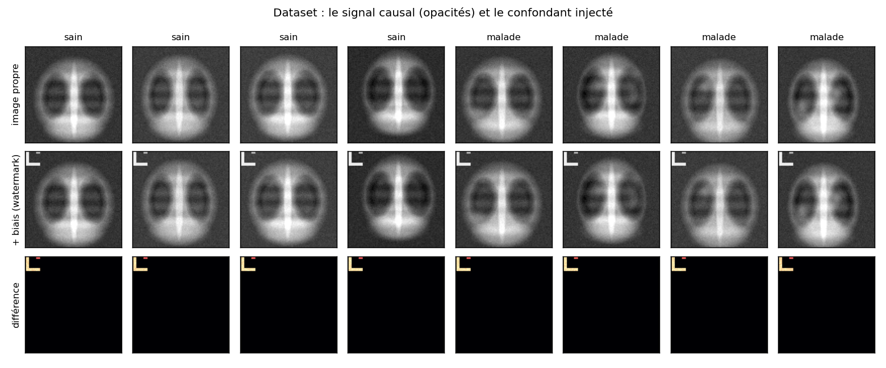
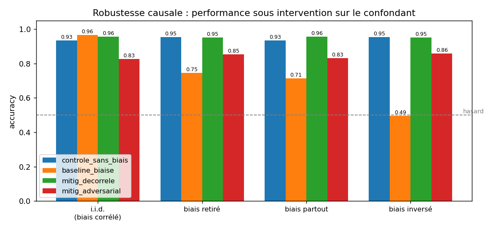
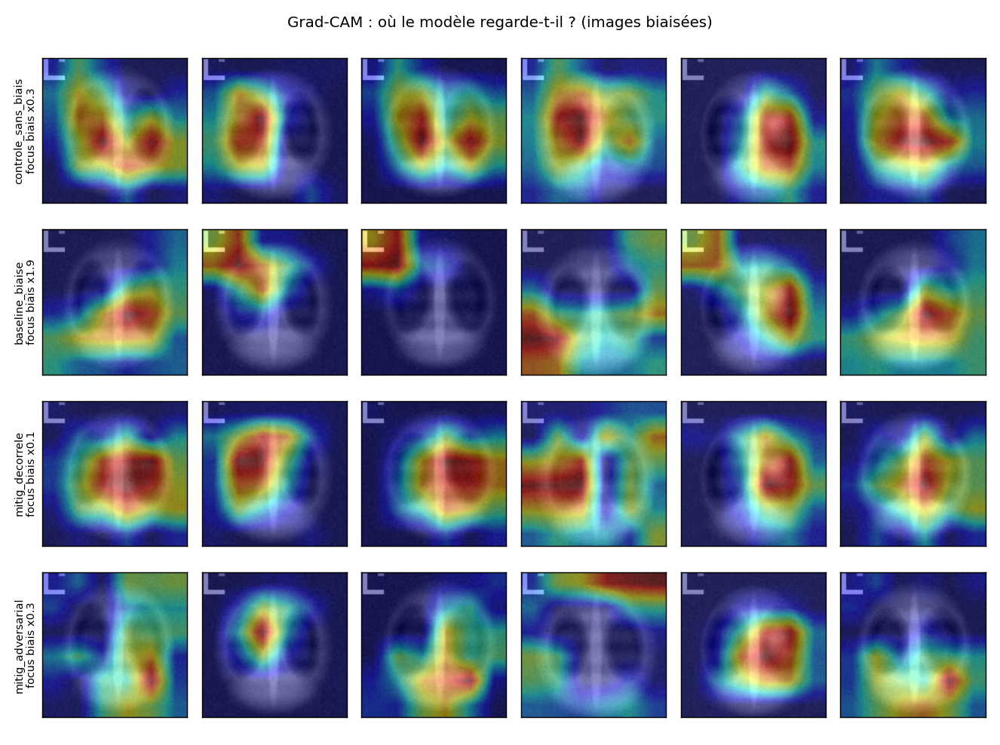

# shortcut-audit
The best-performing model is the only unusable one. Demonstrating, measuring and correcting shortcut learning with counterfactual do(bias) tests.# Causal robustness in medical imaging

Demonstrating, measuring and correcting shortcut learning in a chest X-ray classifier.

A supervised classifier optimises one thing: the separation of classes on the data it is given.
Nothing in that formulation requires the regularities it finds to be clinically meaningful. If
pathological patients come mostly from a different institution than healthy subjects, the
acquisition device becomes a perfect predictor of the label, and the model uses it. The result
is a model that is accurate without being reliable: excellent on its own test set, failing as
soon as the environment changes, because it learned the chain

```
hospital -> visual artefact -> label
```

instead of the causal chain

```
disease -> lung appearance -> label
```

This repository reproduces the phenomenon in a controlled setting where the visual cause of the
label is known by construction, quantifies it through interventional tests, localises it with
Grad-CAM where localisation is possible, and evaluates two corrections.

The central finding: **the best-performing model in the setup is the only unusable one**. It
reaches the highest i.i.d. accuracy (0.965), drops to chance level (0.495) as soon as the
artefact switches class, and 51.7% of its diagnoses flip when a glyph covering 2% of the image
is added or erased.

---

## 1. Protocol

| Step | Question | Files |
|---|---|---|
| Train a standard classifier | is the task learnable? | `src/models.py`, `src/train.py` |
| Inject a controlled confounder | can we create a bias whose semantics we fully control? | `src/bias.py` |
| Test by intervention | does the decision depend on the confounder? | `src/evaluate.py` |
| Visualise attention | can the shortcut be localised? | `src/gradcam.py` |
| Correct | can robustness be restored, and at what cost? | `src/train.py`, `src/run_experiment.py` |

The central methodological point is a design decision: clean images and the artefact are never
merged on disk. Radiographs are generated once; the artefact is applied at the moment the loader
serves the image, according to a separately supplied flag vector. Comparing the model's output
with and without the artefact on the same radiograph therefore amounts to performing an
intervention `do(bias = b)` in Pearl's sense: the confounder's value is forced while everything
else is held constant. What is measured is a causal effect, not an association observed across
different subpopulations.

## 2. Data

The default dataset is generated procedurally (`src/cxr.py`): thoracic silhouette, lung fields,
mediastinum and spine, ribs, diaphragmatic domes, vascular texture, noise and dose variability.
The pathological class is defined by exactly one thing, the presence of diffuse opacities inside
a lung field.

This choice answers a specific constraint. On a real clinical dataset, nobody knows the exact
cause of the label: we know a radiologist made a diagnosis, we do not know which pixels justify
it, nor which confounders coexist in the images. A model can therefore be suspected of cheating,
never shown to. Here the cause is fixed by construction, and any performance obtained without
looking at the opacities is a proven shortcut. The generator also provides the lung field mask,
used only at evaluation time to quantify the model's attention, never during training.

To work on real images (Kaggle `chest_xray`, a PneumoniaMNIST export):

```bash
python src/run_experiment.py --real-data data/chest_xray/train
```

The folder must contain two subfolders, one per class. The rest of the pipeline is unchanged:
the artefact is then injected on top of authentic images, which remains the only way to obtain a
confounder whose semantics are under control.

### Injected confounders

| type | simulates | localised |
|---|---|---|
| `watermark` | burned-in corner marker: laterality letter, device ID, institution logo | yes, roughly 2% of pixels |
| `contrast` | global gamma and gain: different manufacturer, different dose protocol | no |
| `both` | both of the above | partially |

`contrast` is included deliberately: no saliency map can reveal this shortcut, since there is no
suspicious region to point at. The model cheats just as much (section 5). This is what bounds
the reach of saliency-based explainability.

Confounder assignment is governed by a single parameter,
`rho = P(bias=1 | y=1) = P(bias=0 | y=0)`. At 0.95 the confounder is near-perfect; at 0.50 it is
independent of the class; at 0.05 it is anti-correlated.



## 3. Experimental arms

All four arms are trained on exactly the same medical content. Only the confounder distribution
differs; the training sets share the same image array in memory.

| arm | training bias | role |
|---|---|---|
| `controle_sans_biais` | none | causal performance ceiling |
| `baseline_biaise` | `rho = 0.95` | the trap to reproduce |
| `mitig_decorrele` | `rho = 0.50` | correction 1: the confounder stops being informative |
| `mitig_adversarial` | `rho = 0.95`, data identical to the baseline | correction 2: gradient reversal |

**Adversarial correction.** An auxiliary head attempts to predict the bias from the encoder's
features, separated from it by a gradient reversal layer (Ganin and Lempitsky, 2015): identity
on the forward pass, gradient multiplied by `-lambda` on the backward pass. The auxiliary head
optimises its own task normally, while the encoder receives the opposite gradient and is pushed
to make that task impossible. The signal to watch is `adv_acc`, which should approach 0.50. The
value of this correction is that it operates without modifying the data, and therefore applies
when decorrelation is out of reach.

## 4. Metrics

Accuracy on a test set drawn from the same distribution says nothing about the reasons behind a
prediction. Each model is therefore evaluated on four suites built from the same clean images,
with only the confounder configuration varying.

| suite | configuration | interpretation |
|---|---|---|
| `iid` | bias correlated as in training | the accuracy that would be published |
| `no_bias` | artefact removed everywhere | what another institution would see |
| `all_bias` | artefact present everywhere | it no longer discriminates |
| `inverted` | artefact moved to the opposite class | the shortcut becomes a trap |

Three indicators complement accuracy.

- `flip_rate`: the proportion of images whose predicted diagnosis changes between `do(bias=0)`
  and `do(bias=1)`, with lung content held identical. This is the causal effect of the
  confounder, expressed in the unit that matters clinically, the number of patients affected.
- `ate_bias_on_p_malade`: the average change in predicted probability under the same
  intervention. Should be approximately zero.
- `worst_group`: the minimum accuracy across the four (class × bias) groups. At `rho = 0.95`,
  two groups account for less than 5% of the images, and they are precisely the ones the
  shortcut sacrifices. The average hides them entirely.
- `focus_bias` and `focus_lungs`: the share of Grad-CAM mass falling in the artefact region and
  in the lung fields, normalised by the area of the region. A value of 1.0 corresponds to
  uniform attention. Without this normalisation, 20% of the heat concentrated on 2% of the image
  would look unremarkable.

## 5. Results

Reference configuration: 2,500 training images, 800 test images from distinct subjects,
8 epochs, `watermark` artefact, `rho = 0.95`, AdamW optimiser, roughly nine minutes on CPU. Raw
results in `outputs/results.json`.

| model | `iid` | `no_bias` | `all_bias` | `inverted` | worst group | flip rate | artefact attention |
|---|---|---|---|---|---|---|---|
| `controle_sans_biais` | 0.934 | 0.954 | 0.934 | 0.954 | 0.874 | 0.022 | ×0.31 |
| `baseline_biaise` | **0.965** | 0.746 | 0.714 | **0.495** | **0.294** | **0.517** | **×1.87** |
| `mitig_decorrele` | 0.956 | 0.951 | 0.956 | 0.951 | 0.765 | 0.005 | ×0.11 |
| `mitig_adversarial` | 0.826 | 0.854 | 0.830 | 0.858 | 0.647 | 0.051 | ×0.28 |



**The biased model wins on the published metric.** At 0.965 it beats the control arm by three
points; a report showing only this column would conclude that the confounder improved the model.
The `inverted` suite brings it down to 0.495, chance level: it learned the rule "artefact implies
pathological" and applies it in the wrong direction as soon as the correlation flips.

**The flip rate quantifies the mechanism.** 51.7% of diagnoses change when the glyph is added or
erased, with the parenchyma untouched. The average effect on predicted probability reaches
+0.466. The control arm, never exposed to the artefact, stays at 0.022.

**Worst-group accuracy identifies who pays.** On the `iid` suite, the baseline reaches 0.983 on
the 406 pathological patients carrying the artefact, and 0.294 on the 17 who do not. The latter
are overwhelmingly classified as healthy. The model fails precisely on atypical patients, the
ones for whom diagnostic support would be most valuable.

**Grad-CAM localises the shortcut when it is localisable.** The baseline's attention density in
the watermark region reaches 1.87, against 0.31 for the control and 0.11 for the decorrelated
arm. Robust models concentrate their attention on the lung fields (1.86 and 1.82), while the
baseline drops to 1.15 there.



**The global confounder escapes explainability.** With the `contrast` artefact, an independent
check using logistic regression gives 0.959 on `iid` and 0.339 on `inverted`, for a flip rate of
0.685. The magnitude of the shortcut is comparable to the watermark case, yet no saliency map
can reveal it: the transformation is global, there is no suspicious region, and attention would
remain on the thorax. Only the counterfactual tests detect both regimes.

**The two corrections differ in cost.** Decorrelation brings the flip rate down to 0.005 with no
measurable accuracy loss, but assumes the dataset composition can be changed. Adversarial
training works on the unchanged biased data and reduces the dependence to 0.051, at the cost of
roughly ten accuracy points and an unstable run: `adv_acc` falls to 0.598 by the third epoch,
then climbs back to 0.809 by the eighth, instead of converging to 0.50. The reversed gradient is
not the gradient of any actual loss function with respect to the shared parameters, and the
encoder/adversary equilibrium is not reached. The available levers (`--lambda-adv`, ramp
duration, a separate learning rate for the adversary) were not tuned here; the gap with
decorrelation therefore does not measure an intrinsic superiority of the latter.

**A secondary observation.** The control arm loses two accuracy points on the suites where the
artefact is present (0.934 against 0.954), while its flip rate stays at 0.022. What it suffers
is a distribution shift, not a shortcut: the artefact is noise it has never seen. Not having
learned a shortcut does not make a model robust to acquisition artefacts; only accuracy and flip
rate taken together separate the two diagnoses.

### Quick check without PyTorch

`tools/sanity_check_sklearn.py` reproduces the phenomenon in about ten seconds with a logistic
regression: 0.960 on `iid` and 0.209 on `inverted` for the watermark, flip rate 0.831; 0.959 and
0.339 for the contrast bias, flip rate 0.685. Since the CNN and the linear model show the same
collapse, it comes from the data and not from an architectural choice.

## 6. Installation and usage

```bash
pip install -r requirements.txt

# protocol check, no PyTorch required, about 10 s
python tools/sanity_check_sklearn.py

# full experiment: 10 to 20 min on CPU, about 1 min on GPU
python src/run_experiment.py --epochs 8 --n-train 2500

# variants
python src/run_experiment.py --bias contrast    # global confounder
python src/run_experiment.py --rho 0.8          # less perfect confounder
python src/run_experiment.py --arch resnet18    # ResNet-18, no pretrained weights
python src/run_experiment.py --arms baseline_biaise,mitig_adversarial
```

The pipeline writes to `outputs/`: the four figures, `results.json`, `results_table.md` (table
plus an automatic reading per arm), and the weights of each model.

### Code layout

```
src/cxr.py             radiograph generation (pure NumPy, no PyTorch dependency)
src/bias.py            confounder injection and shortcut region of interest
src/data.py            PyTorch Dataset, confounder applied on the fly
src/models.py          compact residual network or ResNet-18, adversarial head and GRL
src/train.py           standard and adversarial training loops
src/evaluate.py        counterfactual suites and causal metrics
src/gradcam.py         Grad-CAM and attention quantification
src/figures.py         figures
src/run_experiment.py  orchestration of the four arms
tools/                 protocol check without PyTorch
```

`cxr.py` does not depend on PyTorch, which lets the check script reuse the generator and the
confounder assignment without installing the framework. Symmetrically, `evaluate.py` and
`gradcam.py` know nothing about the synthetic dataset and work identically on real images.

## 7. Limitations

**Synthetic is not real.** An authentic radiograph contains many entangled confounders (patient
positioning, drains and hardware, age, sex, body habitus, acquisition site), some of them
correlated with disease prevalence. This setup contains one, injected by us. It is a
demonstration of method, not a clinical validation, and the numerical values do not transfer.

**Grad-CAM is not proof.** Saliency maps depend on the chosen layer, are noisy, and the
`contrast` experiment shows they are blind to non-localised shortcuts. They illustrate the
diagnosis; the demonstration rests on the counterfactual suites.

**Decorrelation assumes the confounder is known and annotated.** Yet the most dangerous
confounders are the ones nobody thought to record. Methods that require no group annotation
(Just Train Twice, Learning from Failure, group-DRO with inferred groups) are the natural
extension of this work.

**Invariance has a price.** The confounder here is purely artificial, hence perfectly
uninformative. A real confounding factor may carry legitimate information, in which case forcing
invariance costs genuine accuracy. That is a trade-off to document.

**A single seed per arm** in the default configuration. Order-of-magnitude gaps in flip rate are
unambiguous, but differences of a few thousandths between corrected arms require repetition
across seeds.

**Uncontrolled initialisation across arms.** Models are built successively from the global
random generator, so each arm starts from a different initialisation. Explicitly reseeding
before each construction would make the comparison stricter.

## 8. Extensions

- A partially informative confounder, to study the trade-off between invariance and accuracy.
- Further corrections: group-DRO, group reweighting, invariant risk minimisation, confounder
  randomisation as augmentation.
- Complementary explainability: systematic occlusion, Score-CAM, patch shuffling.
- A disqualification test: train a model on the image corner alone. High accuracy invalidates
  the dataset before any serious training.
- Real out-of-distribution generalisation: train on one institution, test on another.

## 9. References

- R. Geirhos et al., *Shortcut Learning in Deep Neural Networks*, Nature Machine Intelligence,
  vol. 2, pp. 665-673, 2020.
- A. J. DeGrave, J. D. Janizek, S.-I. Lee, *AI for radiographic COVID-19 detection selects
  shortcuts over signal*, Nature Machine Intelligence, vol. 3, pp. 610-619, 2021.
- J. R. Zech et al., *Variable generalization performance of a deep learning model to detect
  pneumonia in chest radiographs*, PLOS Medicine, vol. 15, no. 11, e1002683, 2018.
- Y. Ganin, V. Lempitsky, *Unsupervised Domain Adaptation by Backpropagation*, ICML, 2015.
- R. R. Selvaraju et al., *Grad-CAM: Visual Explanations from Deep Networks via Gradient-based
  Localization*, ICCV, pp. 618-626, 2017.
- S. Sagawa, P. W. Koh, T. B. Hashimoto, P. Liang, *Distributionally Robust Neural Networks for
  Group Shifts*, ICLR, 2020.
- E. Z. Liu et al., *Just Train Twice: Improving Group Robustness without Training Group
  Information*, ICML, 2021.
- J. Nam, H. Cha, S. Ahn, J. Lee, J. Shin, *Learning from Failure: De-biasing Classifier from
  Biased Classifier*, NeurIPS, 2020.
- J. Pearl, *Causality: Models, Reasoning, and Inference*, Cambridge University Press, 2nd ed.,
  2009.

---

François Lachance Awounang-Ngounou, Eng.